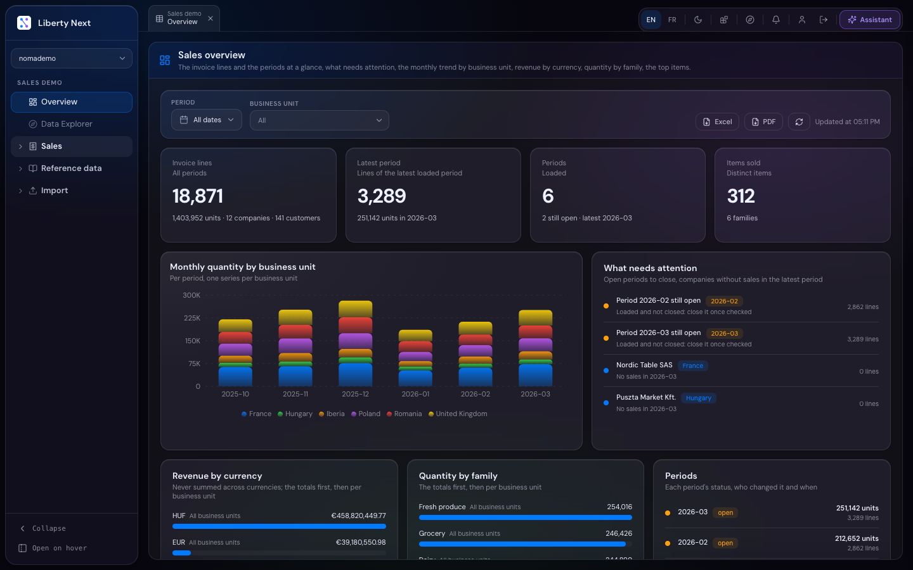
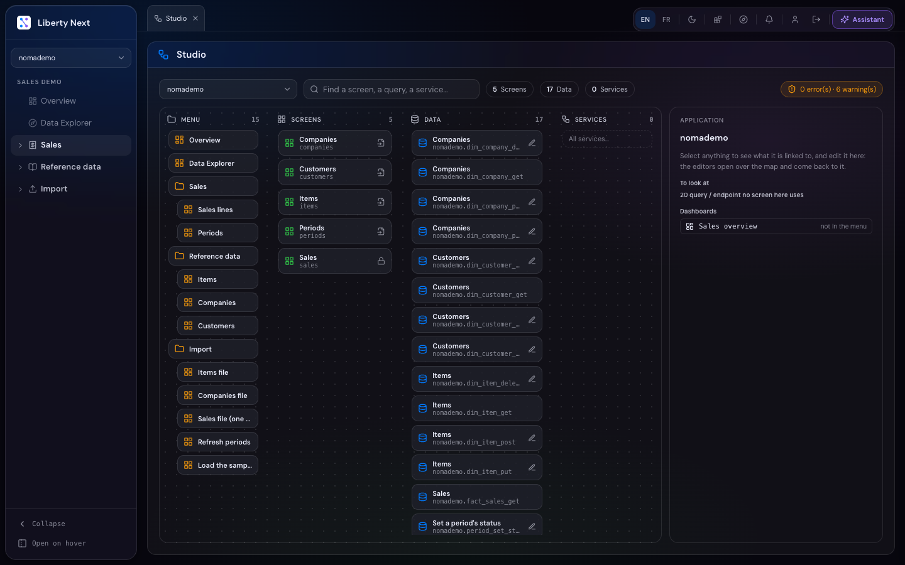
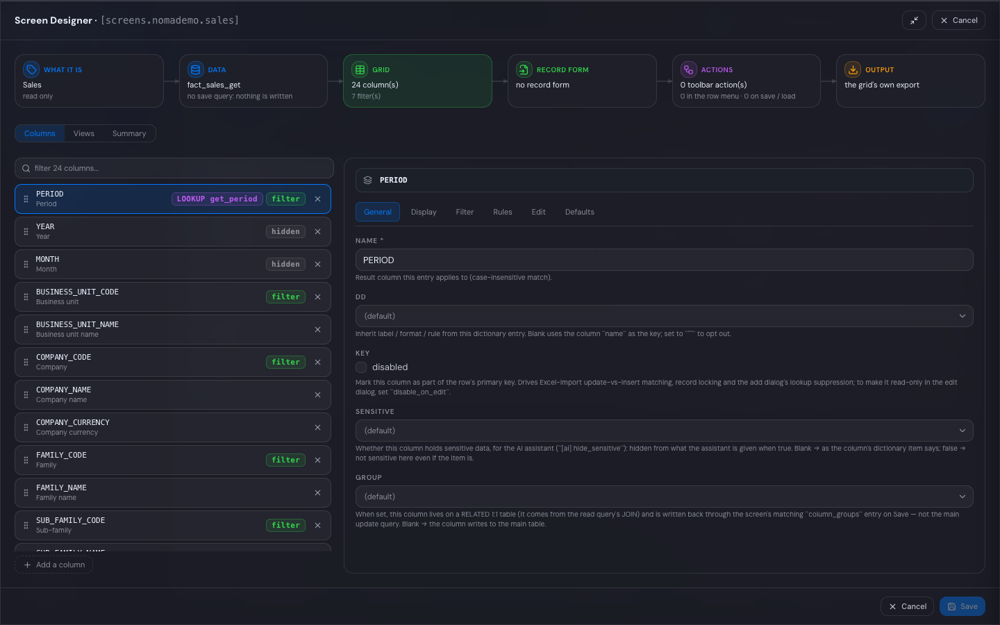
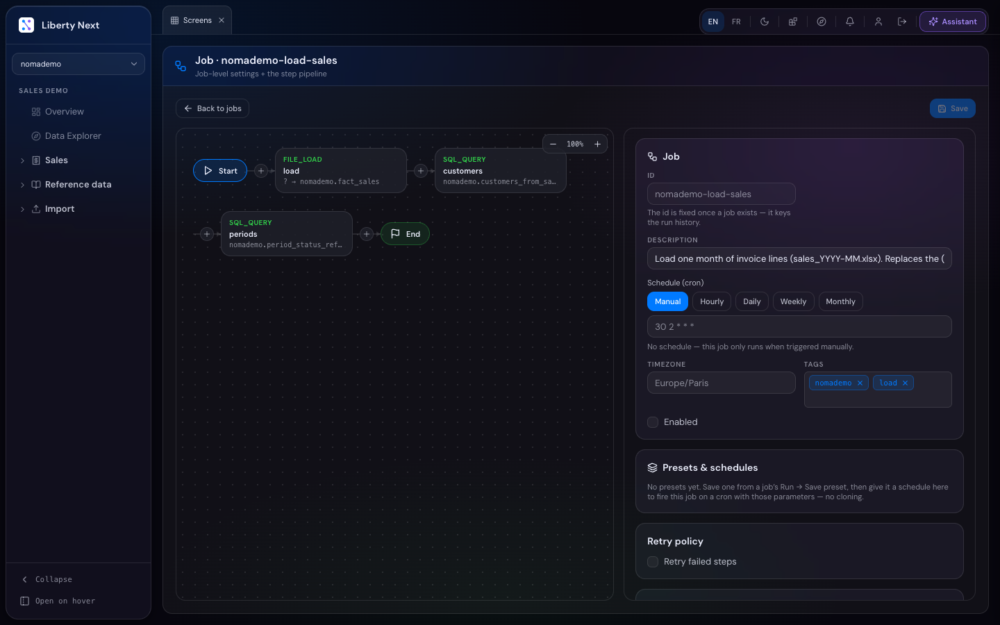

# Liberty Next

[](https://pypi.org/project/liberty-next/)
[](https://pypi.org/project/liberty-next/)
[](https://github.com/fblettner/liberty-next/pkgs/container/liberty-next)
[](https://github.com/fblettner/liberty-next/actions/workflows/release.yml)
[](https://docs.nomana-it.fr/liberty/getting-started/)
[](LICENSE)

### Build business applications from configuration, not code.

Connect your databases and APIs, then describe the screens, dashboards, jobs and rules you
need — in the browser, or in TOML files you keep in Git. Liberty Next runs them: a React
workspace, a REST API, a scheduler, a data explorer, row-level security and an AI assistant
that works on your configuration and your data.

Nothing is generated and nothing is stored as metadata tables: a screen takes its shape from
the query it runs.



**[Documentation](https://docs.nomana-it.fr/liberty/getting-started/)** ·
**[Install](#try-it)** ·
**[Releases](https://github.com/fblettner/liberty-next/releases)** ·
**[Image](https://github.com/fblettner/liberty-next/pkgs/container/liberty-next)** ·
**[Issues](https://github.com/fblettner/liberty-next/issues)**

---

## Why Liberty Next

- **Configuration is the application.** Connectors, screens, menus, dashboards, jobs and
  rules are TOML — validated, versioned before every save, hot-reloaded, and packaged with
  their dependencies to move from one installation to another.
- **Everything is built in the browser.** Each file has its own editor; nobody edits TOML by
  hand unless they want to.
- **Security is not an add-on.** Roles and permissions, single sign-on, and row-level data
  scope applied to every query, export, analysis and write.
- **An assistant that acts as you.** It sees the page you are on, queries your data with
  your rights, proposes screens and queries you apply with one click — and serves the same
  tools to Claude over MCP.
- **Proven.** Three applications run on it in production — JD Edwards security and licence
  auditing, JD Edwards administration, and an ETL scheduler — on PostgreSQL and Oracle.

## What you get

| | |
|---|---|
| **Connectors** | SQL on PostgreSQL and Oracle — and SQL Server, Db2 and IBM i (AS/400) through optional drivers — (named queries, tables with their read and write statements, sequences, audit mirrors), and HTTP APIs with five kinds of authentication. One connector can serve several environments. Secrets are encrypted at rest, never plain text. |
| **Screens** | Grids that stream large results, record forms with tabs and nested tables, cascading filters, row and toolbar actions, bulk edit, Excel import and export, summary, tree and chart views, saved views, record locks. |
| **Dictionary and menus** | One dictionary of data items — labels in every language, formats, lists of values, rules — shared by every screen. A menu per application, a start page per role. |
| **Dashboards and Data Explorer** | KPIs, charts and tables with a period compared with the one before. Explore a model without SQL: rows, measures, filters, pivots, charts, drill to the detail, calculated fields, saved analyses, Excel and PDF. |
| **Jobs** | Steps that run a query, copy a table between databases, load a spreadsheet, call an API, sync from LDAP, run Python, render a report and send it. Schedules, retries, alerts, missed-run detection, a history with logs and files. |
| **Services and tests** | Chain queries, endpoints and conditions into a service, run it, expose it as an API endpoint. Write non-regression tests as a flow of calls, record a reference run, compare. |
| **Notifications** | Rules on screen, job and action events, delivered to the inbox, by e-mail or through a connector. |
| **AI assistant and MCP** | Anthropic-backed, in a drawer over every page: reads with the user's permissions and data scope, writes through a screen as a card you apply, follows the procedures your applications ship. The same tools over MCP for Claude Desktop, claude.ai and Claude Code. |
| **Access** | Local users or OpenID Connect, roles with permissions, row-level data scope from user attributes, login throttling, password reset by mail. |
| **Operations** | Version history with diff and restore, integrity checks, deployment packages, promotion to another instance, monitoring, server log, retention, health and readiness endpoints. |

## How an application is built

The **Studio** shows one application as a whole — its menu, its screens, the data and the
services each one uses, and what nothing uses — and opens every editor in place.



Eight steps, each with its own page in the Liberty Next menu:

1. **Connect the data** — a pool, a connector, its queries.
2. **Name the fields** — the dictionary: labels, formats, lists of values.
3. **Build the screens** — the designer reads like the screen: data, grid, record form, actions.
4. **Organise the menu.**
5. **Add the logic** — services, notifications, tests.
6. **Show the figures** — dashboards, charts, Explorer models.
7. **Give access** — roles, permissions, data scope.
8. **Check and deliver** — integrity, a package, promotion.

| The screen designer | A job, drawn as its flow |
|---|---|
|  |  |

The screenshots show **nomademo**, the demo application (sales analytics loaded from
spreadsheets). The repository also ships a Claude Code skill, `/build-app`, that assembles
an application from a description of the need.

---

## Try it

**Full guide:** <https://docs.nomana-it.fr/liberty/getting-started/> and
[`release/README.md`](release/README.md).

### Docker Compose

A host needs only the `release/` directory:

```bash
git clone --depth 1 --filter=blob:none --sparse https://github.com/fblettner/liberty-next.git
cd liberty-next && git sparse-checkout set release && cd release
./liberty install full                # light = the server + SQLite; full = + Postgres, Traefik, pgAdmin, Portainer
./liberty apps /path/to/liberty_apps-X.Y.Z.whl   # licensed customers: the apps bundle (merge plan + migrations)
./liberty ssl letsencrypt --domain liberty.example.com --email ops@example.com   # optional: TLS
```

`./liberty` is the one operator command: `status | doctor | start | stop | restart | logs |
ssl | apps | db | upgrade | rollback | backup | restore | migrate`. The database can live on an
external PostgreSQL server — at install (`--db external --db-host …`) or later
(`./liberty db external --host …`). An upgrade is
`./liberty upgrade [--tag X.Y.Z]` (doctor → backup → pull → recreate → migrations → report),
undone by `./liberty rollback`. The install prints the `admin` password once.

### PyPI

```bash
pipx install 'liberty-next[all]'      # [all] = PDF reports (needs Pango), LDAP, Alembic
export LIBERTY_JWT_SECRET="$(openssl rand -base64 48 | tr -d '\n=+/')"
export LIBERTY_MASTER_KEY="$(openssl rand -base64 32 | tr -d '\n=+/')"
liberty-admin init-db                 # the auth store + the admin user (prints its password)
liberty-next                          # API + UI on http://localhost:8000
```

The licensed apps on a pipx install: `pipx inject liberty-next liberty_apps-X.Y.Z.whl`,
then `liberty-apps install --target <dir>`, `export LIBERTY_APPS_DIR=<dir>` and
`liberty-admin run-install-jobs`. `liberty-ops` is the Python install's counterpart of the
Docker `liberty` command (status, doctor, backup, restore, migrate, upgrade, rollback).

### From source

```bash
git clone https://github.com/fblettner/liberty-next.git && cd liberty-next
python3.12 -m venv .venv && .venv/bin/pip install -c requirements.txt -e ".[dev]"
./start.sh init-db                    # first run
./start.sh                            # builds the frontend when stale, serves on :8000
./start.sh dev                        # backend auto-reload · ./start.sh frontend → Vite on :5173
.venv/bin/pytest -q                   # 1 800+ tests, no live database needed
(cd frontend && npm ci && npm run lint && npm test && npm run build)
# browser regression tests against a running server (test records only; frontend/e2e/README.md)
(cd frontend && LIBERTY_E2E_USER=… LIBERTY_E2E_PASSWORD=… npm run e2e)
```

---

## Configuration

Everything is TOML under `config/`, or under `LIBERTY_APPS_DIR` when an applications bundle
is installed. Every file has a Pydantic model, an editor in the Liberty Next menu, a version
history and hot reload.

| File | What it carries | Editor |
|---|---|---|
| `app.toml` | Server, sign-in, AI, notifications, reports branding, license, OIDC, jobs settings; encrypted secrets | Administer → App |
| `connectors.toml` | Pools, SQL connectors (tables, queries, sequences, lookups), API connectors | Administer → Pools · Data → Connectors |
| `dictionary.toml` | Data items: labels, formats, enums, lookups, sequences, rules | Data → Dictionary |
| `screens.toml` | Screens: columns, record forms, actions, hooks, views, exports | Screens → Screens |
| `menus.toml` | Per-application navigation and its start page | Screens → Menus |
| `charts.toml` / `dashboards.toml` | Saved charts; dashboards of KPIs, charts and tables with filters and a period | Insight → Charts, Dashboards |
| `explorer.toml` | Data Explorer models and their bundled analyses and dashboards | Insight → Explorer |
| `actions.toml` | Services: shared workflows reused by screens, exposed as endpoints | Logic → Services |
| `notifications.toml` | Notification rules on screen, job and action events | Logic → Notifications |
| `ai.toml` | What the applications ship for the assistant: starter questions, playbooks, tools | Logic → AI |
| `theme.toml` / `reports.toml` | Branding; operator report templates | Administer → Theme · Insight → Report templates |
| `jobs.toml` | Jobs, schedules, presets, retention and missed-schedule policies | Operate → Jobs |
| `auth.toml` | Local users and roles (or the database backend) | Administer → Access |

Two secrets stay in the environment: `LIBERTY_JWT_SECRET` and `LIBERTY_MASTER_KEY` (the
AES-256-GCM key behind every `ENC:` value).

## Framework and applications

The framework is this repository. Applications are configuration plus optional Python, and
ship as a wheel that is merged into the live configuration per entity: new entities are
added, untouched ones refreshed, the operator's own changes kept.

Nomana-IT's applications — **nomasx1** (JD Edwards security, segregation of duties and
licence auditing), **nomajde** (JD Edwards administration) and **nomaflow** (the ETL and
scheduler jobs) — are separate products: their connectors are flagged `licensed = true` and
load only under a license key, set in Administer → App → License and checked with
`liberty-license verify`. Without a key the framework runs with everything that is not
licensed. Your own applications need no key.

## Operating it

| URL | Purpose |
|---|---|
| `/` | The workspace: sign-in, tabs, the Liberty Next menu, the assistant drawer |
| `/docs`, `/redoc`, `/openapi.json` | The API reference |
| `/api/*`, `/admin/*` | The API; the operator endpoints (superuser) |
| `/mcp` | The assistant's tools for an MCP client (when enabled) |
| `/health`, `/ready`, `/info` | Liveness, readiness (pool ping), public counts and versions |
| `/monitoring` | Live view, server log, retention (superuser) |

Deploy → History holds the version history of every file and the upgrade timeline;
Document → Release notes the full changelog in English and French (also in the wheel as
`liberty/RELEASE.md` and `RELEASE.fr.md`).

---

## Develop

`develop` is the working branch; `main` is release-only. Every push to `develop` and every
pull request to `main` runs the CI (ruff, pytest, eslint, vitest, the build). A push to
`main` runs [`release.yml`](.github/workflows/release.yml): it reads the version in
`pyproject.toml` (and bumps the patch when that version is already tagged), requires a real
`## <version>` section in `liberty/RELEASE.md`, builds the wheel and the multi-arch image,
tags, and publishes to PyPI and GitHub.

**Stack.** Python 3.12 · FastAPI · SQLAlchemy 2.0 async · asyncpg · oracledb · Pydantic 2 ·
PyJWT · authlib · argon2 · APScheduler · python-socketio · tomlkit / tomli-w · openpyxl ·
WeasyPrint (optional) · Anthropic SDK — React 19 · Vite · TypeScript · emotion ·
react-i18next · TanStack Table · Recharts · Monaco.

```
liberty/        the framework: main.py (create_app), runtime.py (the reload path), config.py,
                connectors/ auth/ screens/ menus/ charts/ dashboards/ actions/ explorer/ ai/
                jobs/ etl/ reports/ notify/ apptests/ changesets/ versioning/ userviews/ web/ (the HTTP layer)
                RELEASE.md · RELEASE.fr.md · the CLIs (cli, admin_cli, ops_cli, migrate_cli, license_cli, crypto_cli)
frontend/       React 19 + Vite + TypeScript; dist/ is served by the backend; e2e/ = Playwright regression tests
config/         app.toml and the *.toml.example templates
release/        Docker Compose layouts, the `liberty` ops command, install / upgrade / backup scripts, Traefik
docker/         the entrypoint; the Oracle Instant Client is fetched at build (pinned checksums)
tests/          pytest, SQLite fixtures, no live database
.claude/skills/ Claude Code skills shared with the repository (build-app)
```

See [`CLAUDE.md`](CLAUDE.md) for the map of the code and the rules of the house, and
[`CONTRIBUTING.md`](CONTRIBUTING.md) to contribute.

---

## License

Liberty Next is **source-available** under the [Business Source License 1.1](LICENSE) — not an
Open Source license. In short (the license is what counts):

- **Free** to read, copy, modify and fork, and to **run in production** for your own organisation
  and your own applications. Selling the applications, configuration or plugins you built on it is
  yours to do.
- **Not without Nomana-IT's written agreement:** selling or reselling Liberty Next (or a modified
  version of it), or offering it as a paid hosted service.
- Each version becomes available under the **GNU AGPL v3 or later** four years after its release.

`nomasx1`, `nomajde` and Nomana-IT's other applications are separate products, sold separately
and unlocked by a license key ([NOTICE](NOTICE)). Contributions come through forks and pull
requests, under a contributor agreement ([CONTRIBUTING.md](CONTRIBUTING.md)).
